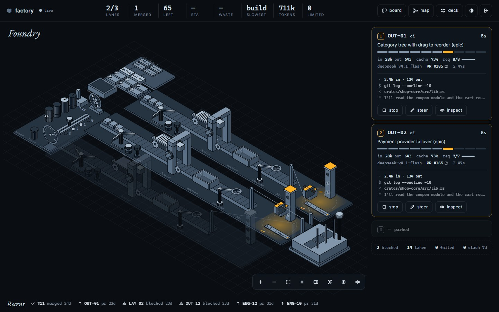

# factory

**Orchestrator should be fun.**

factory works the open issues of a GitHub repository end to end, on its own, and lets you watch
it happen. Each lane takes one issue through the same line:

```
pick → plan → build → verify → review → PR → CI → (merge → deploy → health)
```

Up to three lanes run at once, each in its own sandbox, driven by [opencode](https://opencode.ai).
It runs on OpenCode Zen's free models by default, so it can cost $0. When free models get
rate-limited, add an [OpenCode Go](https://opencode.ai/go) subscription ($10/month) and factory
spends it within caps you set per 5 hours, week and month. A web console shows the whole floor as a small isometric factory, live:
which lane is on which issue, what the model is reading and editing right now, CI checks,
dependencies between issues, and spend. From there you can pause the line, queue or skip an
issue, send a lane a steering note, or stop it.



## Try it in one minute

You need Node 22.12 or newer. Nothing else: no GitHub token, no model key, no Linux.

```bash
git clone https://github.com/dihannahdi/factory && cd factory
npm run demo
```

The first run builds the console (about a minute). Then a simulator plays the engine's side and
the real console opens in your browser with three lanes working through a made-up repository.
Pause the line, queue an issue from the map, steer a lane. Nothing leaves your machine.

In a second terminal:

```bash
npm run status -- --demo --watch
```

`npm link` puts `factory` on your PATH, so this becomes `factory status --demo --watch`.

## Run it on your repository

Today this needs a Linux machine with systemd and root, because every lane is a hardened
transient systemd unit. Check what you have first:

```bash
factory doctor
```

It lists what is missing and the command that fixes each piece. Then follow
[docs/self-hosting.md](docs/self-hosting.md): a sandbox user, opencode, a fine-grained token for
one repository, six labels, one config file (`/etc/factory/instance.env`, where `REPO=owner/name`
is the only required line), and two install scripts. Nothing starts working your repository until
you raise the lane count from 0 in the console.

What it will do to your repository, so there are no surprises:

- It **picks** open issues that have a milestone and no assignee, in priority order, and skips
  anything labelled `agent-skip`, `agent-blocked` or `agent-failed`. Dependencies written as
  `Depends on: #12` are respected.
- It **pushes branches** named `agent/issue-<n>` and **opens PRs** against your default branch.
- It **comments** on issues and PRs when it gives up, waits on a dependency, or adopts an
  existing PR.
- It **does not merge** unless you set `MERGE_MODE=auto`. In the default `pr` mode it stops
  once CI is green and its own review passes, and labels the PR `agent-ready` for a human.
- It **never edits** `.github/` or `deploy/`.

What it costs:

- **$0** with the default free models on OpenCode Zen. Free models come and go and get
  rate-limited; factory refreshes the list every 30 minutes and cools a model down when it
  errors, so the line slows down instead of failing.
- **$10/month** with [OpenCode Go](https://opencode.ai/go), the recommended upgrade when free
  capacity is the bottleneck. You set a budget per 5 hours, week and month
  (`GO_BUDGET_5H`, `GO_BUDGET_WEEK`, `GO_BUDGET_MONTH`); when one runs out the Go models cool
  down until the window resets, and a charge factory did not expect halts every lane.
- **Your CI minutes.** Every PR runs your workflows, sometimes more than once after a fix round.

Read [SECURITY.md](SECURITY.md) before you run it on a repository other people can file issues on.

## How it is put together

```
orchestrator/   the engine: bash, runs as root, one systemd unit per lane
  run.sh          one lane, one unit of work (one issue end to end, or one PR to shepherd)
  sync.sh         every minute: GitHub state, model availability, claims
  sandbox.sh      the only way agent code runs
  prompts/        the four prompts: triage, plan+build, adopt, review
console/        the web console: Node (built-ins only) + Svelte
contracts/      SCHEMA.md, the file contract between the two, and synthetic fixtures
bin/factory.mjs the CLI
deploy/         install scripts
```

The engine and the console never call each other. The engine writes `ui/*.json`; the console
writes `ctl/*.json`; every file has one writer and is replaced atomically. That is why the
console can run against a simulator, and why a CLI can be a third client of the same files.
[contracts/SCHEMA.md](contracts/SCHEMA.md) is the place to start reading.

## Where it is going

The demo, `doctor` and `status` are the first commands. Next are `init` (interactive setup that
writes the config and creates the labels), `up`/`down`, `logs`, `steer`, `spend`, a config file
checked into your repository, and a container runtime so lanes run without root and on macOS.
The plan, with the reasoning and the risks, is in [docs/roadmap.md](docs/roadmap.md).

## Development

```bash
bash orchestrator/test/run-all.sh                       # engine, needs bash and jq, refuses root
node --test bin/test/*.test.mjs                         # CLI
cd console && npm test                                  # console backend
cd console/web && npm ci && npm run check && npm test   # console frontend
```

## License

MIT
